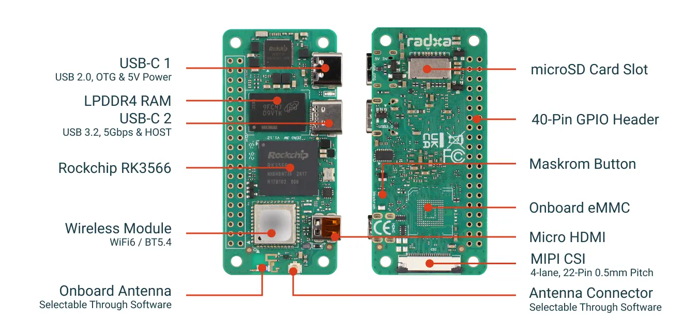
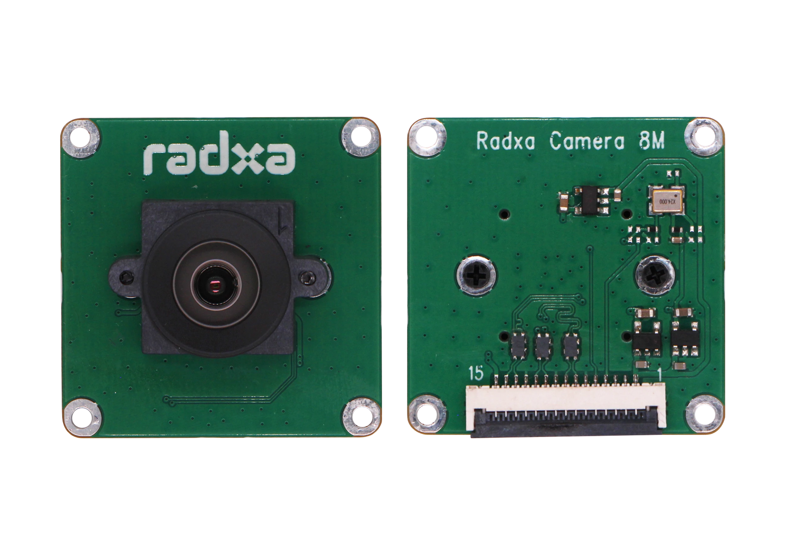
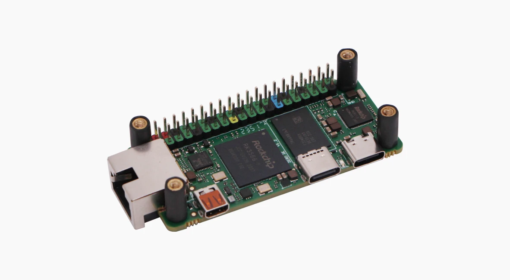
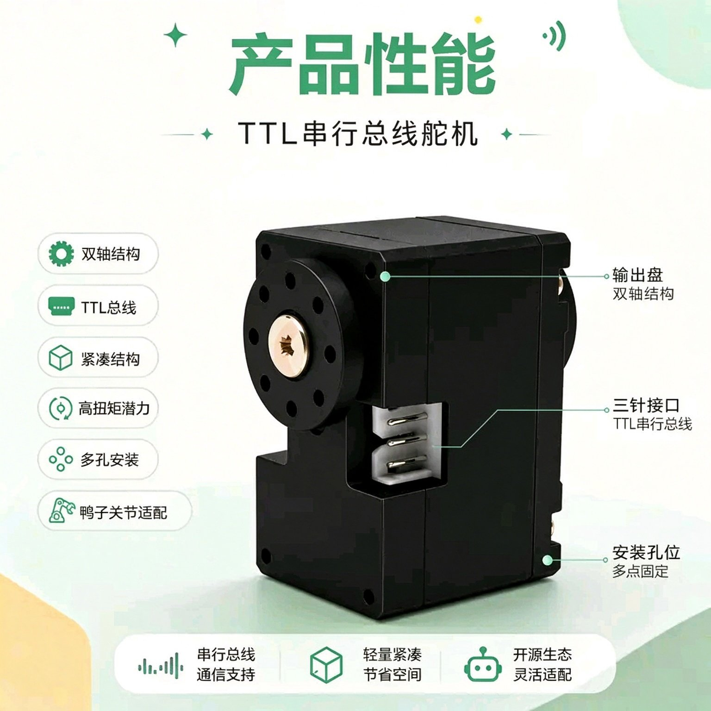
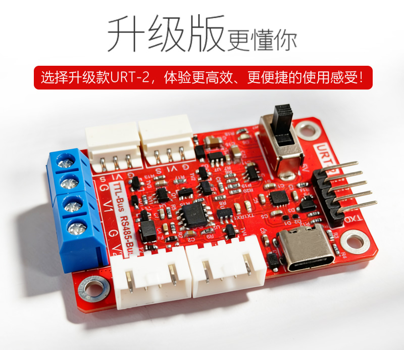
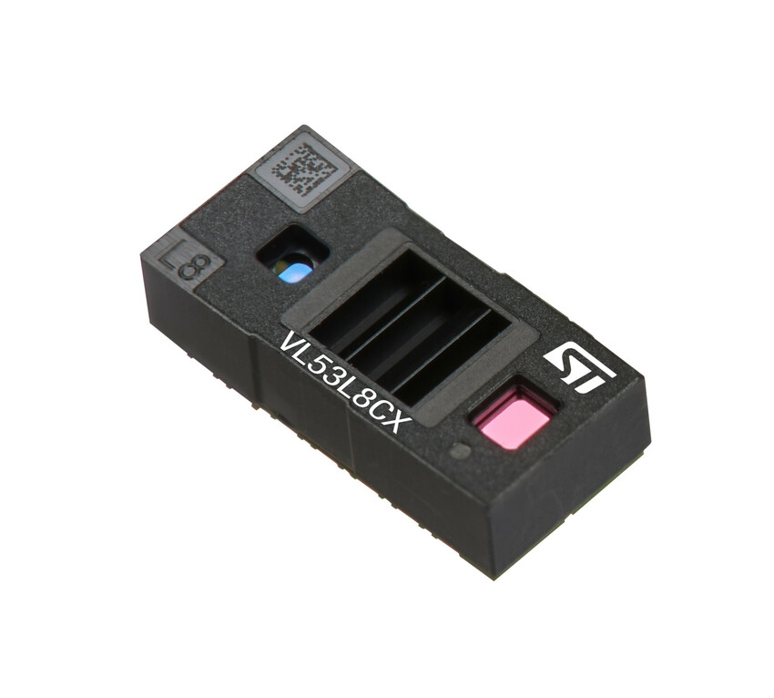
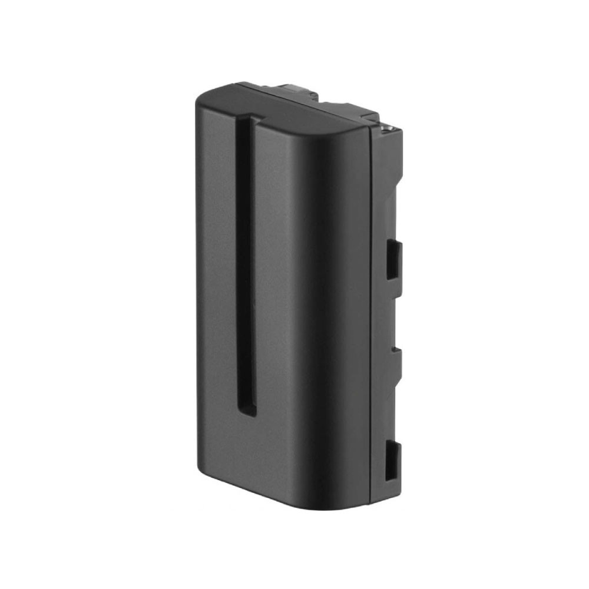
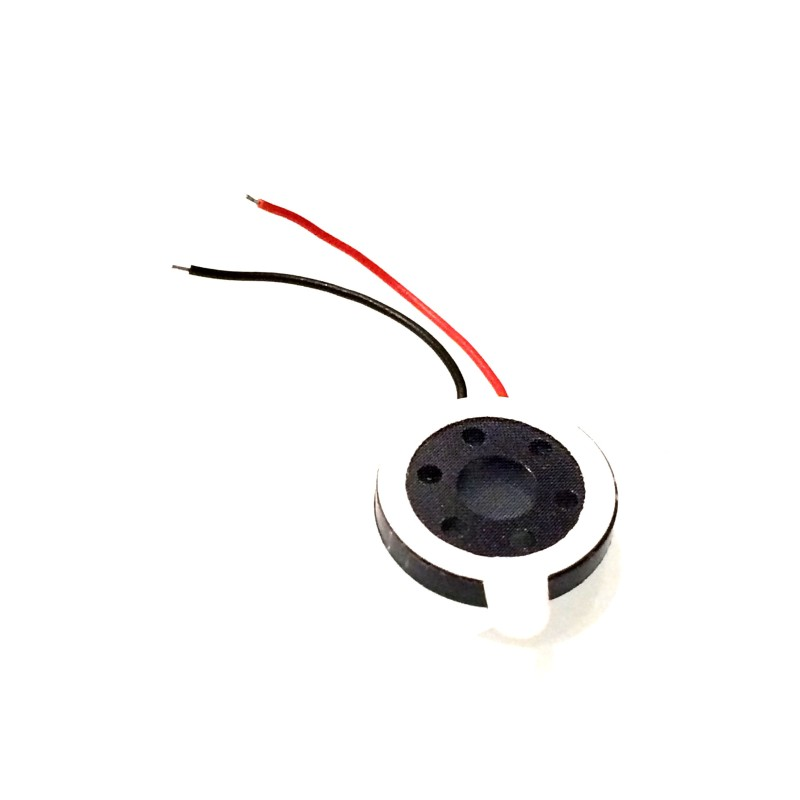
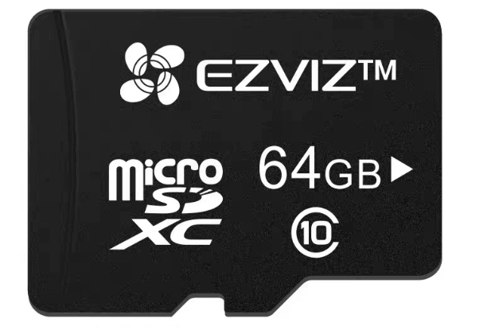
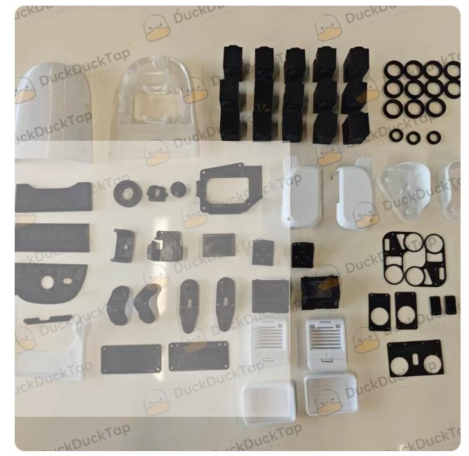

# 配件商城（MicroDuck 散件与配件）

> 本文档与官网配件商城同步：<https://www.wwntai.com/parts.html>
> 价格与库存以官网实时为准；下文产品图均来自官网商城。
> 电子书内同步收录于「第19章：配件商城与备料指南」。

## 现货配件（IN STOCK · 7 天内发货）

### Radxa ZERO 3W 主板

2GB / 无 eMMC / 带排针。超小型 RK3566 单板计算机，WiFi 6 + USB 3.0 + MIPI CSI，适合 IoT 与边缘计算。

| 项目 | 规格 |
|---|---|
| 处理器 | RK3566 四核 Cortex-A55 @1.6GHz |
| GPU | Mali-G52-2EE（Vulkan 1.1 / OpenCL 2.0） |
| 内存 | 2GB LPDDR4 |
| 存储 | MicroSD 卡（无板载 eMMC） |
| 无线 | WiFi 6 + 蓝牙 5.4 |
| 接口 | USB 3.0 + USB 2.0 OTG（Type-C） |
| 显示 | Micro HDMI 1080p60 |
| 摄像头 | MIPI CSI（22-Pin） |
| 尺寸 | 65 × 30 mm · 系统 Debian/Ubuntu |

**¥385** · [立即购买](https://www.wwntai.com/microduck-shop.html?item=Radxa%20ZERO%203W%20%E4%B8%BB%E6%9D%BF&price=385)

### Radxa Camera 8M 219 摄像头

Sony IMX219 · 800 万像素。高分辨率摄像头模组，默认 FPC 排线适配 ZERO 3W/3E，即插即用。

| 项目 | 规格 |
|---|---|
| 传感器 | Sony IMX219，800 万像素 |
| 分辨率 | 3280 × 2464 |
| 帧率 | 最高 30fps（全像素） |
| 镜头 | 焦距 2.95mm · 光圈 F2.5 |
| 视角 | D74° H62° V49° · 畸变 <0.3% |
| 排线 | 150mm（22-Pin 0.5mm） |
| 应用 | 人脸识别 · 车牌识别 · 标线识别 |

**¥180** · [立即购买](https://www.wwntai.com/microduck-shop.html?item=Radxa%20Camera%208M%20219%20%E6%91%84%E5%83%8F%E5%A4%B4&price=180)

### Radxa ZERO 3E PoE HAT

IEEE 802.3af/at。PoE 以太网供电扩展板，单根网线同时供电 + 联网，简化布线。

| 项目 | 规格 |
|---|---|
| 标准 | IEEE 802.3af/at |
| 功能 | 单网线同时供电 + 数据传输 |
| 连接 | 40-Pin GPIO 堆叠 |
| 尺寸 | 65 × 30 mm |
| 附件 | 铜柱 ×4 + 螺丝 ×8 |
| 说明 | 需配合 PoE 交换机/路由器使用 |

**¥118** · [立即购买](https://www.wwntai.com/microduck-shop.html?item=Radxa%20ZERO%203E%20PoE%20HAT&price=118)

### HD-1910-C001 串口总线舵机 15 个套装

FEETECH 空芯杯串口总线舵机，AI 开源专用，适配 MicroDuck 等仿生机器人关节。6V 12kg·cm 堵转扭矩、12 位磁编码 360° 位置反馈、TTL 总线菊花链串联（详细参数见《MicroDuck 电子书》第 1、9、11 章）。

**¥1380** · [立即购买](https://www.wwntai.com/microduck-shop.html?item=HD-1910-C001%20%E4%B8%B2%E5%8F%A3%E6%80%BB%E7%BA%BF%E8%88%B5%E6%9C%BA%2015%20%E4%B8%AA%E5%A5%97%E8%A3%85&price=1380)

### FE-URT2-C001 调试板 + 线材

飞特 USB 转 TTL/485 总线调试板（Type-C · 2.54 排针），配 AMP2.0 双头转接线，用于舵机 ID 配置与总线调试。

**¥49.5** · [立即购买](https://www.wwntai.com/microduck-shop.html?item=FE-URT2-C001%20%E8%B0%83%E8%AF%95%E6%9D%BF%20%2B%20%E7%BA%BF%E6%9D%90&price=49.5)

### VL53L8CX ToF 模块

ST 8×8 多区域 ToF 测距传感器，64 分区同步探测、65° 视角、最远 400cm，实现避障、手势识别与深度感知。

**¥54.9** · [立即购买](https://www.wwntai.com/microduck-shop.html?item=VL53L8CX%20ToF%20%E6%A8%A1%E5%9D%97&price=54.9)

### 唯卓仕 NP-F550 电池组

唯卓仕 VILTROX NP-F550 锂电池：2200mAh / 7.4V，USB-C 直充约 2 小时，4 格 LED 电量显示，尺寸 70.7×38.5×25mm，重约 110g，可拆卸快换。

**¥49** · [立即购买](https://www.wwntai.com/microduck-shop.html?item=%E5%94%AF%E5%8D%93%E4%BB%95NP-F550%20%E7%94%B5%E6%B1%A0%E7%BB%84&price=49)

### 扬声器模组

扬声器模组，让机器鸭能「说」，支持语音反馈与提示音。

**¥5.9** · [立即购买](https://www.wwntai.com/microduck-shop.html?item=%E6%89%AC%E5%A3%B0%E5%99%A8%E6%A8%A1%E7%BB%84&price=5.9)

### 萤石 64G 监控专用高速 TF 卡

萤石 64G 内存卡，监控专用高速卡，视频录像 TF 存储卡，读速 90MB/s。

**¥60** · [立即购买](https://www.wwntai.com/microduck-shop.html?item=%E8%90%A4%E7%9F%B3%2064G%20%E7%9B%91%E6%8E%A7%E4%B8%93%E7%94%A8%E9%AB%98%E9%80%9F%20TF%20%E5%8D%A1&price=60)

### 标准件套装（轴承 · 螺丝 · 螺纹胶 · 防滑垫）

| 内容 | 数量 |
|---|---|
| 轴承 10×15×3 | ×3 |
| 轴承 16×22×4 | ×11 |
| 轴承 6×12×3（轮滑） | ×4 |
| 自攻螺丝 平尾 M2×5 | ×1包 |
| 自攻螺丝 平尾 M2×6 | ×1包 |
| 自攻螺丝 平尾 M2×8 | ×1包 |
| 自攻螺丝 平尾 M2.5×6 | ×1包 |
| 自攻螺丝 平尾 M2.5×8 | ×1包 |
| 乐泰螺纹胶 243 | ×1 |
| 鞋底防滑垫 | ×1 |

**¥99** · [立即购买](https://www.wwntai.com/microduck-shop.html?item=%E6%A0%87%E5%87%86%E4%BB%B6%E5%A5%97%E8%A3%85%EF%BC%88%E8%BD%B4%E6%89%BF%20%C2%B7%20%E8%9E%BA%E4%B8%9D%20%C2%B7%20%E8%9E%BA%E7%BA%B9%E8%83%B6%20%C2%B7%20%E9%98%B2%E6%BB%91%E5%9E%AB%EF%BC%89&price=99)

### 代装整机服务

散件代装 + 首跑调试一站式服务。专业工程师组装、烧录、首跑验证，到手即用，适合想省心的用户。

**¥699** · [立即购买](https://www.wwntai.com/microduck-shop.html?item=%E4%BB%A3%E8%A3%85%E6%95%B4%E6%9C%BA%E6%9C%8D%E5%8A%A1&price=699)

## MicroDuck 国产版配件（即将上线）

开源双足机器鸭的散件与扩展配件，个人开发者友好。

### 整机散件包

MicroDuck 全部零件一次配齐：3D 打印结构件、电子件、15 颗 HD-1910-C001 舵机、RK3566 主控、NP-F550 电池组。附中英双语组装教程，从零件到会走路的机器鸭，开箱即装。

**¥2580** · 即将上线

### 3D 打印结构件套装

全套外壳 + 骨架结构件，FDM / 光固化工艺可选，图纸全量开源。公差与干涉问题清单公开，打印即装，复现成功率高。

**¥128** · 即将上线

### 轮滑套件

轮滑套件，让机器鸭从「走」进化到「滑」，解锁轮滑行为，移动更快更流畅。

**¥49** · 即将上线

### 游戏手柄

蓝牙手柄，零代码直接玩。连上即可遥控机器鸭行走、踢球，秒变遥控玩具。

**¥79** · 即将上线

### 电子件

- **imu_to_dxl 电路板**：IMU 转 Dynamixel 协议桥接板，microduck-replica 开源方案的姿态数据转换。价格待定。
- **Banana PCB + 香蕉插头 PCB（铜镀金）**：2.5mm 香蕉插头 PCB（铜镀金）× 2 + banana PCB（嘉立创）× 1。价格待定。

## 待上线（COMING SOON）

| 产品 | 状态 |
|---|---|
| Radxa ZERO 3W 1GB 版 | 待上线 |
| Radxa ZERO 3W 4GB 版 | 待上线 |
| Radxa ZERO 3W 8GB 版 | 待上线 |
| Radxa ZERO 3E（千兆网口版） | 待上线 |

## 如何购买

1. **点击购买**：在官网商城卡片上点「立即购买」，自动带入所选配件；
2. **支付宝扫码付款**：核对金额后扫码付款，记下转账单号；
3. **填单提交**：填写转账单号，把订单信息发给客服，确认后安排发货。

## 加入配件交流群（下单/答疑）

**小鸭子的配件（主板，舵机群 2）** · 下单：<https://wwntai.com>

使用微信或企业微信扫码加入。

> ⚠️ 微信群二维码 7 天自动失效（本图有效期至 **2026-10-31**）。过期后请访问官网 <https://www.wwntai.com/parts.html> 获取最新二维码，或在 GitHub 仓库提 issue 更新。
