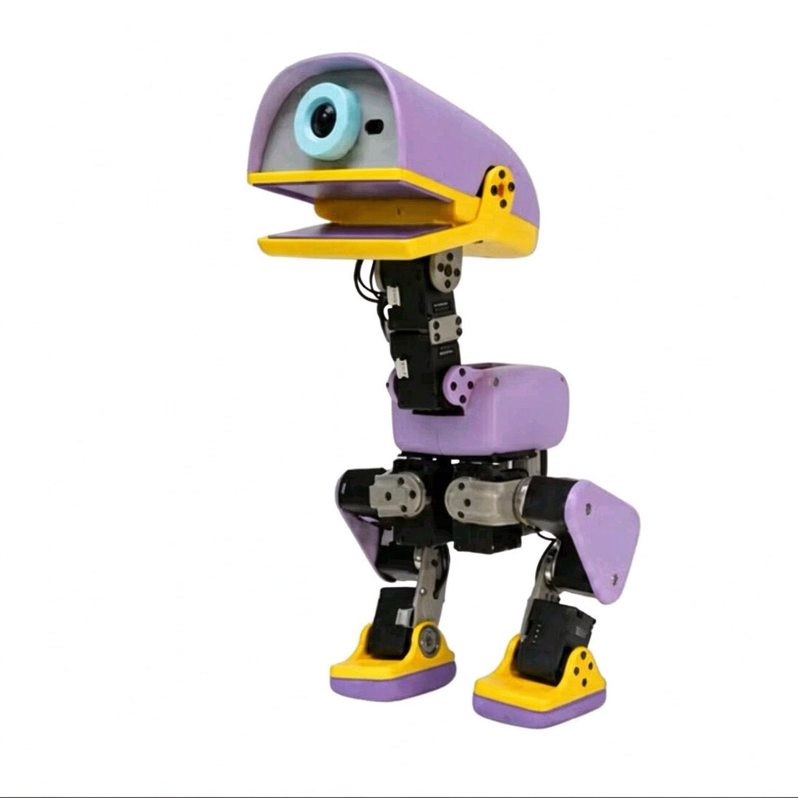
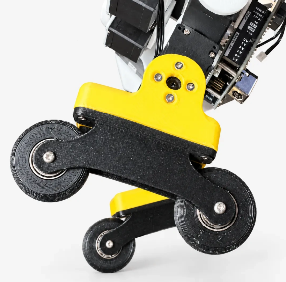

# Parts Store and Procurement Guide

> This chapter is synchronized with the official parts store: <https://www.wwntai.com/parts.html>
> Prices and stock are subject to the official site in real time; the product images below are all from the official store.
>
> Source your parts before replicating MicroDuck: this chapter brings the store's components and accessories (servos, mainboards, batteries, cameras, etc.) into the book with images and descriptions, so readers can one-stop procure against the BOM.

## 19.1 In-Stock Parts (IN STOCK · ships within 7 days)

### Radxa ZERO 3W Mainboard

2 GB / no eMMC / with pin headers. An ultra-compact RK3566 single-board computer with WiFi 6 + USB 3.0 + MIPI CSI, suited to IoT and edge computing.

| Item | Specification |
|---|---|
| Processor | RK3566 quad-core Cortex-A55 @ 1.6 GHz |
| GPU | Mali-G52-2EE (Vulkan 1.1 / OpenCL 2.0) |
| Memory | 2 GB LPDDR4 |
| Storage | MicroSD card (no onboard eMMC) |
| Wireless | WiFi 6 + Bluetooth 5.4 |
| Interfaces | USB 3.0 + USB 2.0 OTG (Type-C) |
| Display | Micro HDMI 1080p60 |
| Camera | MIPI CSI (22-pin) |
| Dimensions | 65 × 30 mm · Debian/Ubuntu |

**¥385** · [Buy now](https://www.wwntai.com/microduck-shop.html?item=Radxa%20ZERO%203W%20%E4%B8%BB%E6%9D%BF&price=385)

### Radxa Camera 8M 219

Sony IMX219 · 8 megapixels. A high-resolution camera module whose stock FPC cable matches the ZERO 3W/3E, plug-and-play.

| Item | Specification |
|---|---|
| Sensor | Sony IMX219, 8 MP |
| Resolution | 3280 × 2464 |
| Frame rate | up to 30 fps (full pixel) |
| Lens | focal length 2.95 mm · aperture F2.5 |
| Field of view | D74° H62° V49° · distortion < 0.3% |
| Cable | 150 mm (22-pin, 0.5 mm) |
| Applications | face recognition · license-plate recognition · lane-line recognition |

**¥180** · [Buy now](https://www.wwntai.com/microduck-shop.html?item=Radxa%20Camera%208M%20219%20%E6%91%84%E5%83%8F%E5%A4%B4&price=180)

### Radxa ZERO 3E PoE HAT

IEEE 802.3af/at. A Power-over-Ethernet expansion board that delivers power and networking over a single cable, simplifying wiring.

| Item | Specification |
|---|---|
| Standard | IEEE 802.3af/at |
| Function | Power + data over a single Ethernet cable |
| Connection | 40-pin GPIO stacking |
| Dimensions | 65 × 30 mm |
| Accessories | standoffs ×4 + screws ×8 |
| Note | requires a PoE switch/router |

**¥118** · [Buy now](https://www.wwntai.com/microduck-shop.html?item=Radxa%20ZERO%203E%20PoE%20HAT&price=118)

### HD-1910-C001 Serial-Bus Servo, 15-Pack

FEETECH coreless serial-bus servo, dedicated for open-source AI, suited to the joints of MicroDuck and other biomimetic robots. 12 kg·cm stall torque at 6 V, 12-bit magnetic-encoder 360° position feedback, TTL bus daisy-chaining (see Introduction: Pollen MicroDuck and Open-Source Embodied Intelligence, Servo and IMU Calibration, and BAM Actuator Modeling and Identification for details).

**¥1380** · [Buy now](https://www.wwntai.com/microduck-shop.html?item=HD-1910-C001%20%E4%B8%B2%E5%8F%A3%E6%80%BB%E7%BA%BF%E8%88%B5%E6%9C%BA%2015%20%E4%B8%AA%E5%A5%97%E8%A3%85&price=1380)

### FE-URT2-C001 Debug Board + Cables

Feetech USB-to-TTL/485 bus debug board (Type-C · 2.54 mm header), with an AMP2.0 dual-ended adapter cable, for servo ID configuration and bus debugging.

**¥49.5** · [Buy now](https://www.wwntai.com/microduck-shop.html?item=FE-URT2-C001%20%E8%B0%83%E8%AF%95%E6%9D%BF%20%2B%20%E7%BA%BF%E6%9D%90&price=49.5)

### VL53L8CX ToF Module

ST 8×8 multi-zone Time-of-Flight ranging sensor: 64-zone simultaneous detection, 65° field of view, range up to 400 cm, enabling obstacle avoidance, gesture recognition, and depth sensing.

**¥54.9** · [Buy now](https://www.wwntai.com/microduck-shop.html?item=VL53L8CX%20ToF%20%E6%A8%A1%E5%9D%97&price=54.9)

### Viltrox NP-F550 Battery Pack

VILTROX NP-F550 lithium battery: 2200 mAh / 7.4 V, USB-C direct charging in ~2 hours, 4-segment LED charge indicator, dimensions 70.7×38.5×25 mm, ~110 g, hot-swappable.

**¥49** · [Buy now](https://www.wwntai.com/microduck-shop.html?item=%E5%94%AF%E5%8D%93%E4%BB%95NP-F550%20%E7%94%B5%E6%B1%A0%E7%BB%84&price=49)

### Speaker Module

A speaker module that lets the robot duck "speak," supporting voice feedback and alert tones.

**¥5.9** · [Buy now](https://www.wwntai.com/microduck-shop.html?item=%E6%89%AC%E5%A3%B0%E5%99%A8%E6%A8%A1%E7%BB%84&price=5.9)

### EZVIZ 64 GB High-Speed TF Card for Surveillance

EZVIZ 64 GB memory card, a high-speed card dedicated to surveillance and video recording, with 90 MB/s read speed.

**¥60** · [Buy now](https://www.wwntai.com/microduck-shop.html?item=%E8%90%A4%E7%9F%B3%2064G%20%E7%9B%91%E6%8E%A7%E4%B8%93%E7%94%A8%E9%AB%98%E9%80%9F%20TF%20%E5%8D%A1&price=60)

### Standard Hardware Kit (bearings · screws · threadlocker · anti-slip pads)

| Contents | Quantity |
|---|---|
| Bearing 10×15×3 | ×3 |
| Bearing 16×22×4 | ×11 |
| Bearing 6×12×3 (roller-skate) | ×4 |
| Self-tapping screw, flat-end M2×5 | ×1 pack |
| Self-tapping screw, flat-end M2×6 | ×1 pack |
| Self-tapping screw, flat-end M2×8 | ×1 pack |
| Self-tapping screw, flat-end M2.5×6 | ×1 pack |
| Self-tapping screw, flat-end M2.5×8 | ×1 pack |
| Loctite threadlocker 243 | ×1 |
| Sole anti-slip pads | ×1 |

**¥99** · [Buy now](https://www.wwntai.com/microduck-shop.html?item=%E6%A0%87%E5%87%86%E4%BB%B6%E5%A5%97%E8%A3%85%EF%BC%88%E8%BD%B4%E6%89%BF%20%C2%B7%20%E8%9E%BA%E4%B8%9D%20%C2%B7%20%E8%9E%BA%E7%BA%B9%E8%83%B6%20%C2%B7%20%E9%98%B2%E6%BB%91%E5%9E%AB%EF%BC%89&price=99)

### Full-Assembly Service

A one-stop service for kit assembly + first-run debugging. Professional engineers assemble, flash, and verify the first run, so the robot works out of the box — ideal for users who want peace of mind.

**¥699** · [Buy now](https://www.wwntai.com/microduck-shop.html?item=%E4%BB%A3%E8%A3%85%E6%95%B4%E6%9C%BA%E6%9C%8D%E5%8A%A1&price=699)

## 19.2 MicroDuck Domestic-Edition Parts (Coming Soon)

Components and expansion accessories for the open-source bipedal robot duck, friendly to individual developers.

### Complete Kit

All MicroDuck parts in one package: 3D-printed structural parts, electronics, 15 HD-1910-C001 servos, RK3566 mainboard, and NP-F550 battery pack. Includes a bilingual (Chinese/English) assembly tutorial — from parts to a walking robot duck, assemble out of the box.

**¥2580** · Coming soon

### 3D-Printed Structural Parts Kit

Full shell + skeleton structural parts, with FDM / resin (SLA) options available; all drawings fully open-sourced. A public list of tolerance and interference issues means print-and-assemble with a high success rate.

**¥128** · Coming soon

### Roller-Skate Kit

A roller-skate kit that upgrades the robot duck from "walking" to "rolling," unlocking roller behaviors for faster, smoother motion.

**¥49** · Coming soon

### Game Controller

A Bluetooth controller, playable with zero code. Connect and remotely drive the robot duck to walk and kick a ball — instantly a remote-control toy.

**¥79** · Coming soon

### Electronics

- **imu_to_dxl board**: an IMU-to-Dynamixel protocol bridge board, converting attitude data for the microduck-replica open-source solution. Price TBD.
- **Banana PCB + banana-plug PCB (gold-plated copper)**: 2.5 mm banana-plug PCB (gold-plated copper) ×2 + banana PCB (JLC) ×1. Price TBD.

## 19.3 Coming Soon

| Product | Status |
|---|---|
| Radxa ZERO 3W 1 GB | Coming soon |
| Radxa ZERO 3W 4 GB | Coming soon |
| Radxa ZERO 3W 8 GB | Coming soon |
| Radxa ZERO 3E (gigabit Ethernet version) | Coming soon |

## 19.4 How to Order

1. **Click to buy**: on the store card, click "Buy now," which auto-fills the selected part;
2. **Pay via Alipay QR**: verify the amount, scan to pay, and record the transfer number;
3. **Submit the order form**: fill in the transfer number and send the order details to customer service; after confirmation, shipping is arranged.

### Join the Parts Community Group (ordering / Q&A)

**MicroDuck Parts (Mainboard, Servo Group 2)** · Order at: <https://wwntai.com>

Scan with WeChat or WeCom to join.

> ⚠️ The WeChat group QR code expires automatically after 7 days (this image is valid until **2026-10-31**). After expiry, visit <https://www.wwntai.com/parts.html> for the latest QR code, or open a GitHub issue to update it.

## 19.5 A Note from the Founder

> **The MicroDuck Parts Store · For anyone who has hit the same pitfalls**

In open-source robotics, the most grinding part is often not the code, but the parts.

A part suddenly goes out of stock, and after two weeks you find it cannot ship; the camera cable you bought doesn't match the mainboard; the servo specs look right, but after installing it you discover the protocol is incompatible; to assemble a full set of fasteners you visit three shops and pay three shipping fees, only to find one screw still missing. We have been through all of this ourselves.

The MicroDuck Parts Store was never a platform we planned from the start; it is more like a shelf gradually forced into existence by those pitfalls. Our capabilities are limited — we can't do everything — so we focus on doing one thing as well as we can: helping individual developers who are reproducing open-source robots avoid one more selection headache and one more wasted trip.

### A few things we are working hard to do

- **Being upfront about stock status.** In-stock parts are marked "ships within 7 days"; coming-soon items are announced in advance, so nobody places an order and then discovers an indefinite wait. Unstable supply is the reality, and we choose to state that reality up front.
- **Spelling out compatibility.** Which board a camera cable fits, which joint a servo suits, what prerequisites a PoE HAT requires, exactly how many screws of what size are in the hardware kit — we don't hide these details, because developers know better than anyone what one wrong choice costs.
- **Showing where quality comes from.** Sensor models, servo brands, battery specs, TF-card uses — we publish the key parameters as openly as we can. We don't claim every item is the optimal choice, but at least you know what you are buying.
- **Consolidating scattered purchases into one order.** The complete kit, structural parts, electronics, standard hardware, and optional accessories are listed together with clear prices and one-click ordering. The full-assembly service is an extra option for those who want peace of mind, not a requirement.

### What the store has now

In-stock and orderable today: the Radxa ZERO 3W mainboard, the 8M 219 camera, the PoE HAT, the 15-pack of HD-1910-C001 servos, the debug board, the VL53L8CX ToF module, the NP-F550 battery pack, the speaker module, the 64 GB high-speed TF card, the standard hardware kit, and the full-assembly service.

Coming soon: the MicroDuck domestic-edition complete kit, the 3D-printed structural-parts kit, the roller-skate kit, the game controller, the imu_to_dxl board, the banana-plug PCB, and the ZERO 3W 1 GB/4 GB/8 GB and ZERO 3E gigabit-Ethernet versions. The structural-part drawings are fully open-sourced, and the tolerance-and-interference issue list is public too — a slightly higher reproduction success rate is the sincerity we can offer.

The purchase path is kept simple: click to buy → pay via Alipay QR code → fill in shipping details and the transfer number → copy the order to customer service.

### A few honest words

We know this store is still far from perfect. The selection isn't large enough, some parts are still on the way, and customer service may not always be on call. But it has been built up piece by piece around real reproduction scenarios, and every parameter, every image, and every "coming soon" came from a concrete problem we hit while building our own machines.

If, during purchasing or assembly, you find something written wrong, something missing, or something that could be clearer, please tell us directly. Individual developers already have a hard enough time doing hardware; if this little shelf can save you a bit of time, that is the meaning of what we do.

—— Chi Ching Ip (Henry Ip), CEO of WWNT Robotics

> The MicroDuck Parts Store — we are still learning, and we'll try our best not to let those who come later step into the same pit again.
