# 配件商城与备料指南

> 本章与配件商城同步：<https://shop.wwntai.com>
> 价格与库存以商城实时为准；下文产品图均来自商城。
>
> 复刻 MicroDuck 前先备料：本章把配件商城的散件与配件（舵机、主控、电池、摄像头等）图文并茂收录进来，方便读者对照 BOM 一站式采购。

## 19.1 现货配件（IN STOCK · 7 天内发货）

### Radxa ZERO 3W 主板

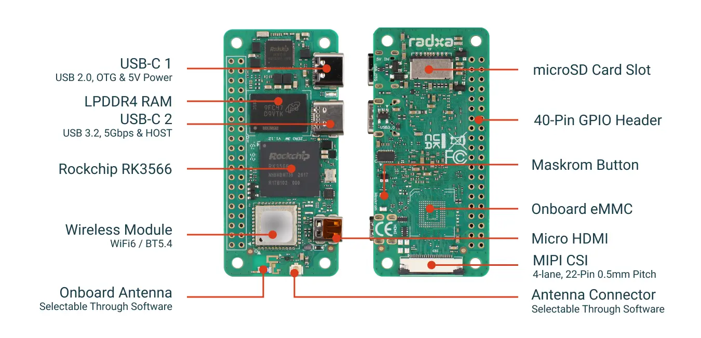

2GB / 无 eMMC / 带排针。超小型 RK3566 单板计算机，WiFi 6 + USB 3.0 + MIPI CSI，适合 IoT 与边缘计算。

| 项目 | 规格 |
|---|---|
| 处理器 | RK3566 四核 Cortex-A55 @1.6GHz |
| GPU | Mali-G52-2EE（Vulkan 1.1 / OpenCL 2.0） |
| 内存 | 2GB LPDDR4 |
| 存储 | MicroSD 卡（无板载 eMMC） |
| 无线 | WiFi 6 + 蓝牙 5.4 |
| 接口 | USB 3.0 + USB 2.0 OTG（Type-C） |
| 显示 | Micro HDMI 1080p60 |
| 摄像头 | MIPI CSI（22-Pin） |
| 尺寸 | 65 × 30 mm · 系统 Debian/Ubuntu |

**¥385** · [立即购买](https://shop.wwntai.com)

### Radxa Camera 8M 219 摄像头

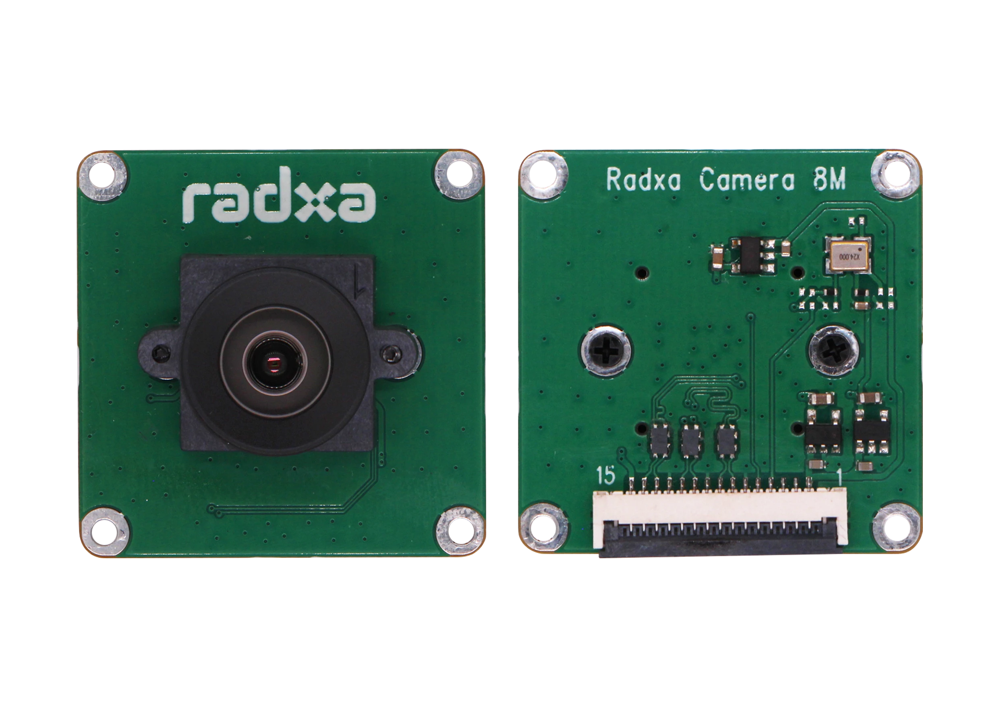

Sony IMX219 · 800 万像素。高分辨率摄像头模组，默认 FPC 排线适配 ZERO 3W/3E，即插即用。

| 项目 | 规格 |
|---|---|
| 传感器 | Sony IMX219，800 万像素 |
| 分辨率 | 3280 × 2464 |
| 帧率 | 最高 30fps（全像素） |
| 镜头 | 焦距 2.95mm · 光圈 F2.5 |
| 视角 | D74° H62° V49° · 畸变 <0.3% |
| 排线 | 150mm（22-Pin 0.5mm） |
| 应用 | 人脸识别 · 车牌识别 · 标线识别 |

**¥180** · [立即购买](https://shop.wwntai.com)

### Radxa ZERO 3E PoE HAT

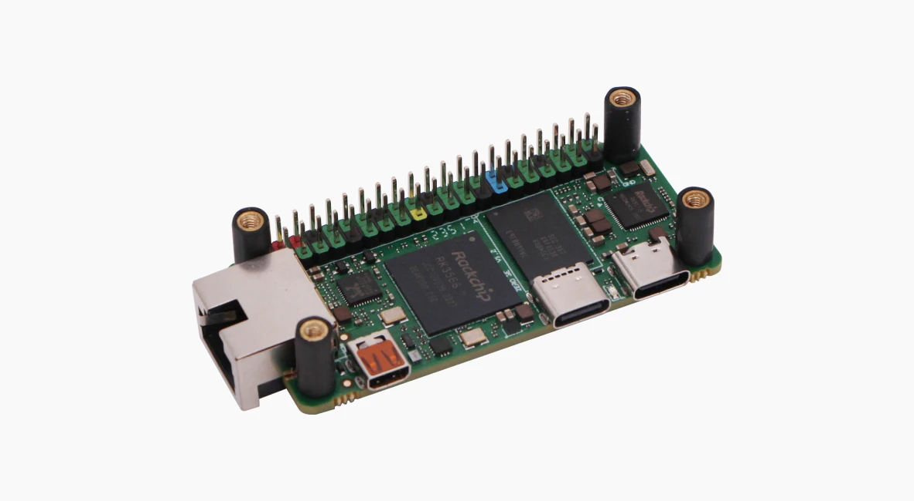

IEEE 802.3af/at。PoE 以太网供电扩展板，单根网线同时供电 + 联网，简化布线。

| 项目 | 规格 |
|---|---|
| 标准 | IEEE 802.3af/at |
| 功能 | 单网线同时供电 + 数据传输 |
| 连接 | 40-Pin GPIO 堆叠 |
| 尺寸 | 65 × 30 mm |
| 附件 | 铜柱 ×4 + 螺丝 ×8 |
| 说明 | 需配合 PoE 交换机/路由器使用 |

**¥118** · [立即购买](https://shop.wwntai.com)

### HD-1910-C001 串口总线舵机 15 个套装

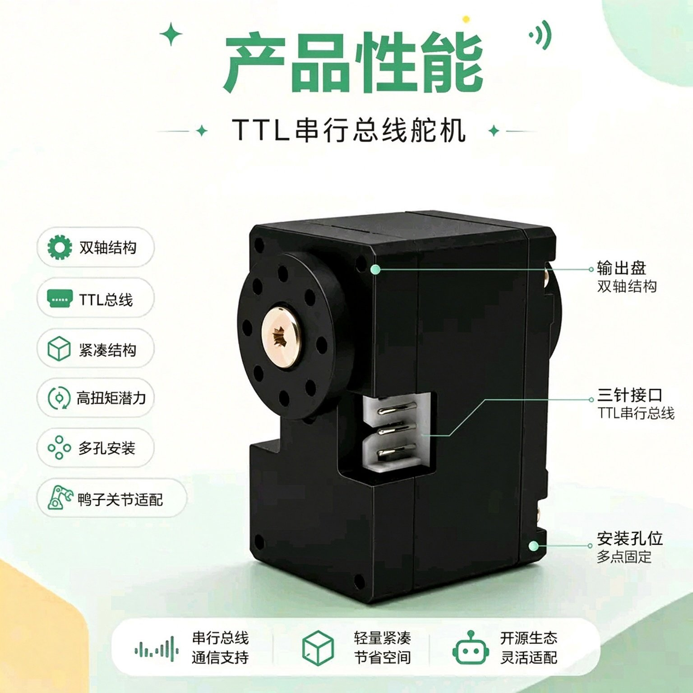

FEETECH 空芯杯串口总线舵机，AI 开源专用，适配 MicroDuck 等仿生机器人关节。6V 12kg·cm 堵转扭矩、12 位磁编码 360° 位置反馈、TTL 总线菊花链串联（详细参数见第 1、8、10 章）。

**¥1380** · [立即购买](https://shop.wwntai.com)

### FE-URT2-C001 调试板 + 线材

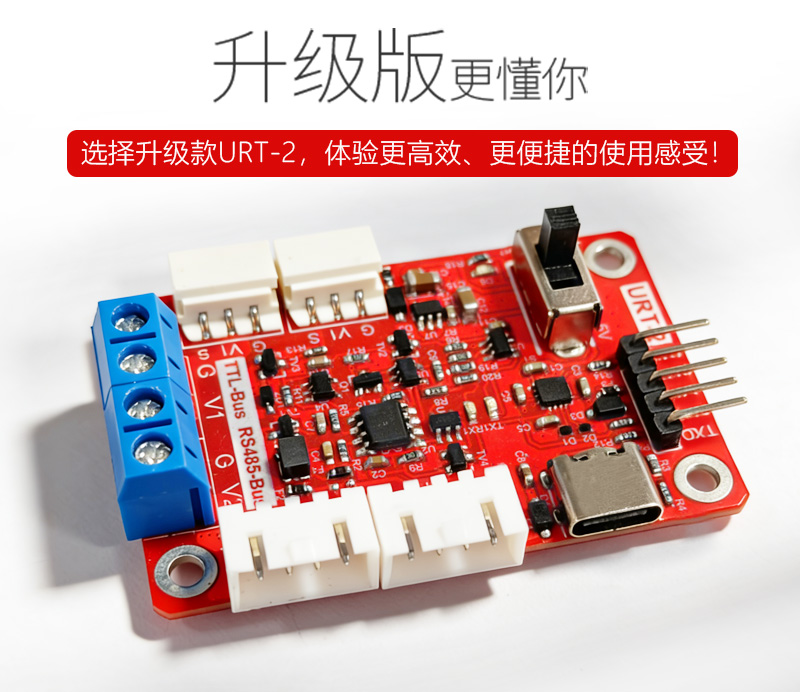

飞特 USB 转 TTL/485 总线调试板（Type-C · 2.54 排针），配 AMP2.0 双头转接线，用于舵机 ID 配置与总线调试。

**¥49.5** · [立即购买](https://shop.wwntai.com)

### VL53L8CX ToF 模块

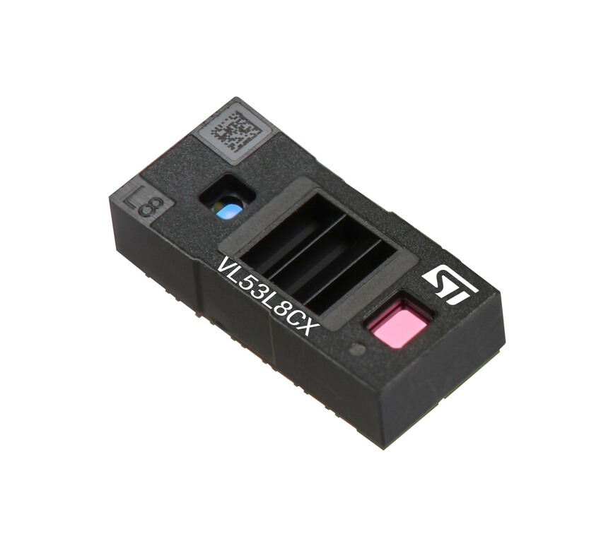

ST 8×8 多区域 ToF 测距传感器，64 分区同步探测、65° 视角、最远 400cm，实现避障、手势识别与深度感知。

**¥54.9** · [立即购买](https://shop.wwntai.com)

### 唯卓仕 NP-F550 电池组

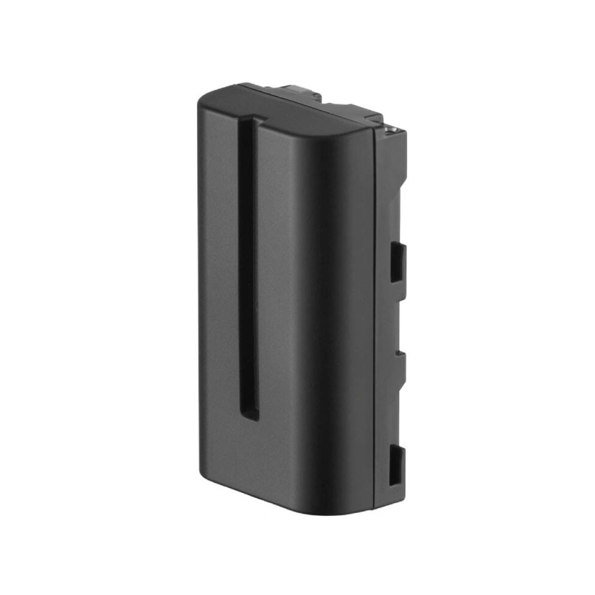

唯卓仕 VILTROX NP-F550 锂电池：2200mAh / 7.4V，USB-C 直充约 2 小时，4 格 LED 电量显示，尺寸 70.7×38.5×25mm，重约 110g，可拆卸快换。

**¥49** · [立即购买](https://shop.wwntai.com)

### 扬声器模组

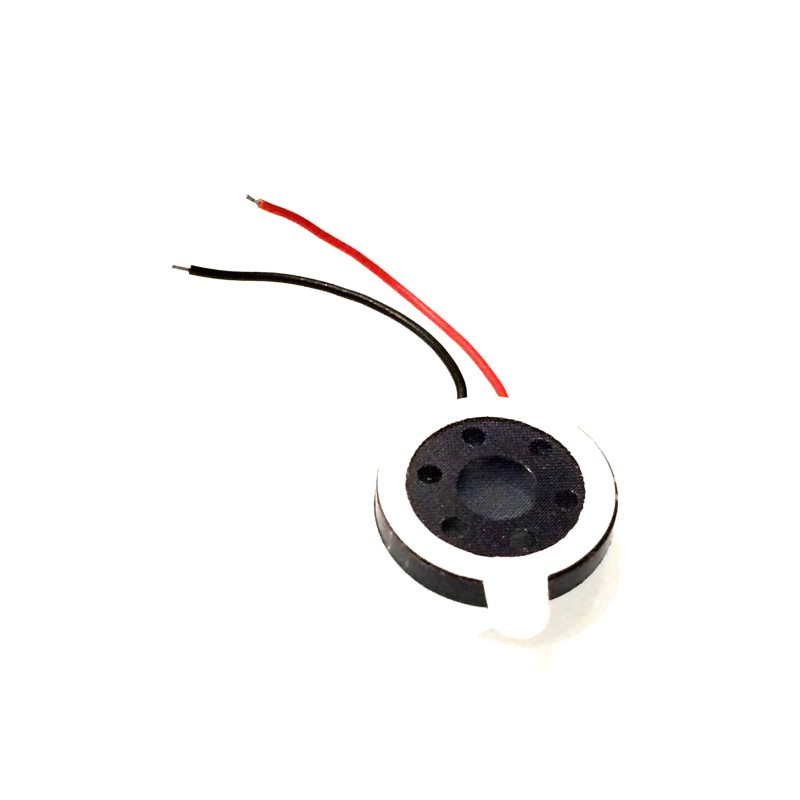

扬声器模组，让机器鸭能「说」，支持语音反馈与提示音。

**¥5.9** · [立即购买](https://shop.wwntai.com)

### 萤石 64G 监控专用高速 TF 卡

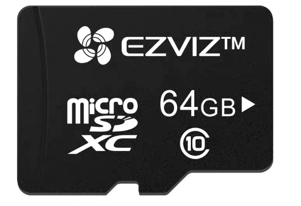

萤石 64G 内存卡，监控专用高速卡，视频录像 TF 存储卡，读速 90MB/s。

**¥60** · [立即购买](https://shop.wwntai.com)

### 标准件套装（轴承 · 螺丝 · 螺纹胶 · 防滑垫）

| 内容 | 数量 |
|---|---|
| 轴承 10×15×3 | ×3 |
| 轴承 16×22×4 | ×11 |
| 轴承 6×12×3（轮滑） | ×4 |
| 自攻螺丝 平尾 M2×5 | ×1包 |
| 自攻螺丝 平尾 M2×6 | ×1包 |
| 自攻螺丝 平尾 M2×8 | ×1包 |
| 自攻螺丝 平尾 M2.5×6 | ×1包 |
| 自攻螺丝 平尾 M2.5×8 | ×1包 |
| 乐泰螺纹胶 243 | ×1 |
| 鞋底防滑垫 | ×1 |

**¥99** · [立即购买](https://shop.wwntai.com)

### 代装整机服务

散件代装 + 首跑调试一站式服务。专业工程师组装、烧录、首跑验证，到手即用，适合想省心的用户。

**¥699** · [立即购买](https://shop.wwntai.com)

## 19.2 MicroDuck 国产版配件（即将上线）

开源双足机器鸭的散件与扩展配件，个人开发者友好。

### 整机散件包

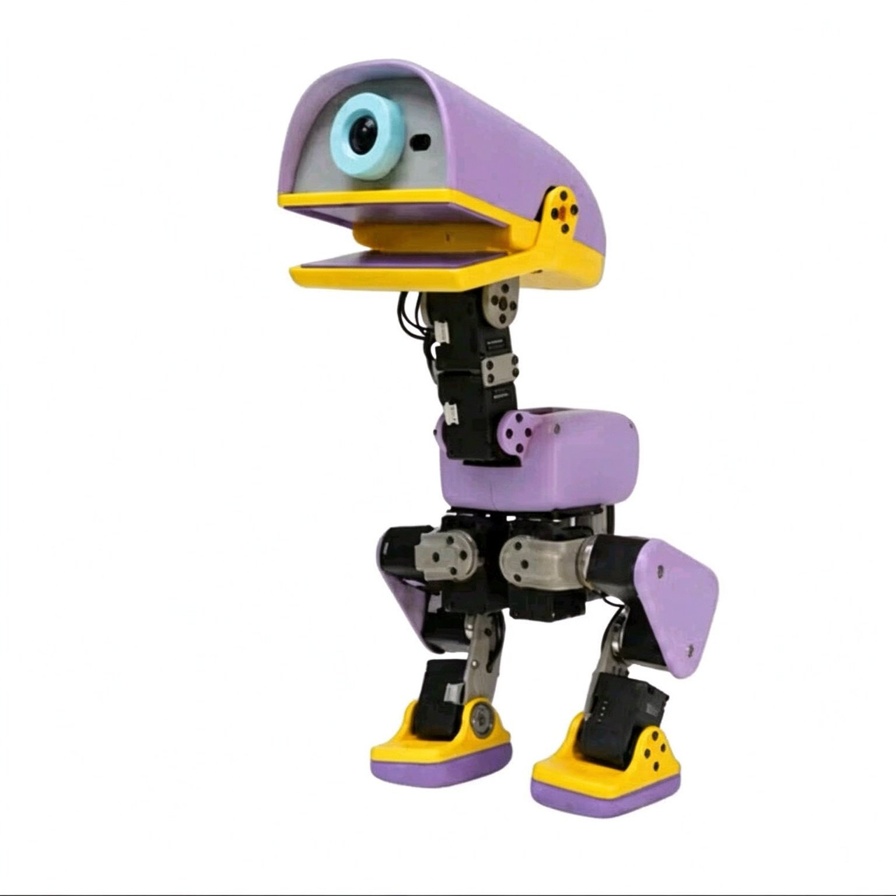

MicroDuck 全部零件一次配齐：3D 打印结构件、电子件、15 颗 HD-1910-C001 舵机、RK3566 主控、NP-F550 电池组。附中英双语组装教程，从零件到会走路的机器鸭，开箱即装。

**¥2580** · 即将上线

### 3D 打印结构件套装

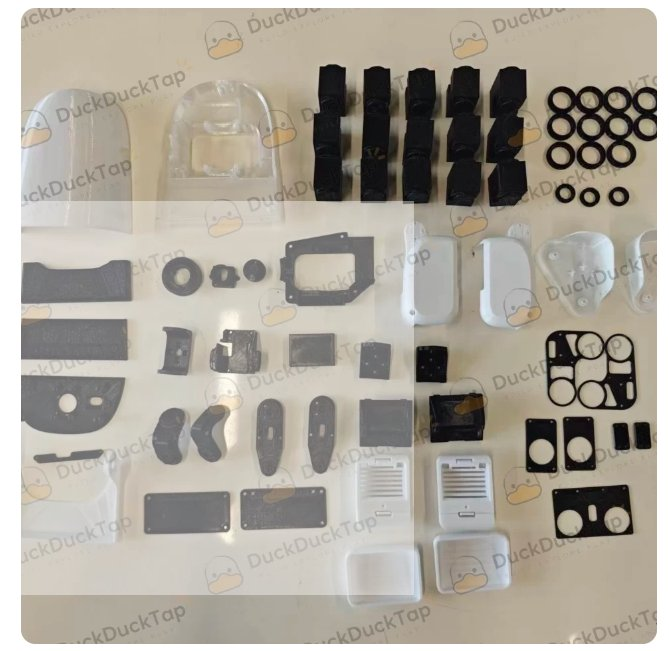

全套外壳 + 骨架结构件，FDM / 光固化工艺可选，图纸全量开源。公差与干涉问题清单公开，打印即装，复现成功率高。

**¥128** · 即将上线

### 轮滑套件

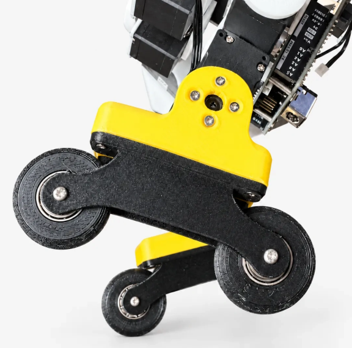

轮滑套件，让机器鸭从「走」进化到「滑」，解锁轮滑行为，移动更快更流畅。

**¥49** · 即将上线

### 游戏手柄

蓝牙手柄，零代码直接玩。连上即可遥控机器鸭行走、踢球，秒变遥控玩具。

**¥79** · 即将上线

### 电子件

- **imu_to_dxl 电路板**：IMU 转 Dynamixel 协议桥接板，microduck-replica 开源方案的姿态数据转换。价格待定。
- **Banana PCB + 香蕉插头 PCB（铜镀金）**：2.5mm 香蕉插头 PCB（铜镀金）× 2 + banana PCB（嘉立创）× 1。价格待定。

## 19.3 待上线（COMING SOON）

| 产品 | 状态 |
|---|---|
| Radxa ZERO 3W 1GB 版 | 待上线 |
| Radxa ZERO 3W 4GB 版 | 待上线 |
| Radxa ZERO 3W 8GB 版 | 待上线 |
| Radxa ZERO 3E（千兆网口版） | 待上线 |

## 19.4 如何购买

1. **点击购买**：在商城卡片上点「立即购买」，自动带入所选配件；
2. **支付宝扫码付款**：核对金额后扫码付款，记下转账单号；
3. **填单提交**：填写转账单号，把订单信息发给客服，确认后安排发货。

### 加入配件交流群（下单/答疑）

**Microduck 商城 2 群** · 下单：<https://shop.wwntai.com>

使用微信或企业微信扫码加入。

> ⚠️ 微信群二维码 7 天自动失效（本图有效期至 **2026-11-09**）。过期后请访问官网 <https://shop.wwntai.com> 获取最新二维码，或在 GitHub 仓库提 issue 更新。

## 19.5 创始人寄语

> **MicroDuck 配件商城 · 写给同样踩过坑的你**

做开源机器人，最磨人的往往不是代码，而是零件。

配件突然断货，等了两周发现发不了；买回来的摄像头排线对不上主板；舵机参数看着差不多，装上去才发现协议不兼容；为了凑齐一套标准件，跑了三家店、付了三次运费，最后还少一颗螺丝。这些事，我们自己都经历过。

MicroDuck 配件商城不是一开始就规划好的平台，它更像是被这些坑一点点逼出来的一个货架。我们能力有限，做不到大而全，只能尽量把一件事做好：让个人开发者在复现开源机器人时，少一次选型焦虑，少一趟冤枉路。

### 我们正在努力做的几件小事

- **把库存状态说清楚**：现货可下单的配件标注 7 天内发货，即将上线的提前公示，不让人下了单才发现要无限等待。供应不稳定是现实，我们选择把现实讲在前面。
- **把匹配关系写明白**：摄像头排线适配哪块板、舵机适配哪个关节、PoE HAT 需要什么前提、标准件套装里到底有几颗什么规格的螺丝——这些细节不藏着，因为选错一次的成本，开发者比谁都清楚。
- **把质量来源摆出来**：传感器型号、舵机品牌、电池规格、TF 卡用途，关键参数尽量公开可查。我们不敢说每一件都是最优解，但至少让你知道自己在买什么。
- **把零散采购收拢到一张订单**：整机散件、结构件、电子件、标准件、可选配件放在一起，明码标价，点击即购。代装整机服务也是给想省心的朋友多一个选择，不是必须。

### 商城现在有什么

现货可下单的有 Radxa ZERO 3W 主板、8M 219 摄像头、PoE HAT、15 颗 HD-1910-C001 舵机套装、调试板、VL53L8CX ToF 模块、NP-F550 电池组、扬声器模组、64G 高速 TF 卡、标准件套装和代装整机服务。

即将上线的有 MicroDuck 国产版整机散件包、3D 打印结构件套装、轮滑套件、游戏手柄、imu_to_dxl 电路板、香蕉插头 PCB，以及 ZERO 3W 1GB/4GB/8GB 和 ZERO 3E 千兆网口版。结构件图纸全量开源，公差与干涉问题清单也公开，复现成功率高一些，是我们能给的诚意。

购买路径也尽量简单：点击购买 → 支付宝扫码付款 → 填收货信息与转账单号 → 复制订单发客服。

### 一点心里话

我们知道这个商城还远不完美。品类不够多，部分配件还在路上，客服可能也不是随叫随到。但它是围绕真实复现场景一点点搭起来的，每一条参数、每一张图、每一个「即将上线」，都来自我们自己装机器时遇到过的具体问题。

如果你在采购或组装过程中发现哪里写错了、缺了什么、哪里还能更清楚，欢迎直接告诉我们。个人开发者做硬件已经够不容易了，能在这个小货架上帮你省下一点时间，就是我们做它的意义。

—— 万物拟态 CEO **叶志青（Henry Ip）**

> MicroDuck 配件商城 —— 我们也在学，尽量不让后来的人再踩同一个坑。
